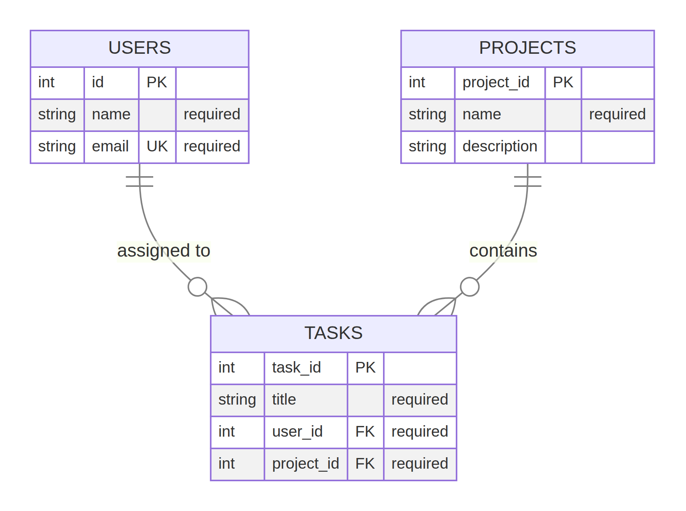

# TaskBridge ERD Fix

This submission corrects the flawed TaskBridge Entity Relationship Diagram (ERD) and implements the corrected model as an executable PostgreSQL schema. The system contains users, projects, and tasks. A task must be assigned to exactly one user and belong to exactly one project, while each user and project may be associated with many tasks.

## Problems in the Original ERD

The supplied ERD and starter SQL contained several structural and integrity problems.

| Problem | Evidence in the original design | Impact | Correction |
|---|---|---|---|
| The `users.id` attribute was not defined as a primary key | The starter schema declared `id SERIAL` without `PRIMARY KEY` | User rows could not be reliably identified or referenced | `users.id` is now the primary key |
| Task relationships were only represented as integer columns | `tasks.user_id` and `tasks.project_id` had no foreign-key constraints | Invalid or orphaned user/project references could be inserted | Both columns are required foreign keys |
| Required values were nullable | `name`, `email`, `project.name`, and `task.title` had no `NOT NULL` constraints | Incomplete records could be stored | Required attributes are `NOT NULL` |
| Duplicate user emails were not prevented | `users.email` had no uniqueness constraint | Multiple accounts could use the same email address | `users.email` is `UNIQUE` |
| `task_owner_name` was redundant | The ERD stored the owner’s name in `tasks` even though `user_id` identifies the owner | The owner name could disagree with the related user record and would require repeated updates | The attribute is removed; the owner is obtained through `tasks.user_id` |
| Relationship cardinality was incomplete | The original diagram emphasized the user-task relationship but did not clearly enforce the project-task relationship | A task could be created without a valid project | The corrected ERD models both one-to-many relationships |

## Corrected Design

The corrected ERD contains three normalized entities. `USERS` stores identity and contact data, `PROJECTS` stores project data, and `TASKS` stores task data plus the two foreign keys required to identify its owner and project. The derived owner name is intentionally not duplicated in `TASKS`; it can be retrieved with a join to `USERS`.



The relationship rules are:

| Relationship | Cardinality | Database implementation |
|---|---:|---|
| One user to tasks | `USERS 1 : many TASKS` | `tasks.user_id NOT NULL REFERENCES users(id)` |
| One project to tasks | `PROJECTS 1 : many TASKS` | `tasks.project_id NOT NULL REFERENCES projects(project_id)` |
| User email uniqueness | One email per user | `users.email UNIQUE NOT NULL` |

The Mermaid source used to render the image is included as [`corrected_erd.mmd`](corrected_erd.mmd) so the design remains reviewable and reproducible.

## Database Schema Explanation

The schema in [`schema.sql`](schema.sql) creates all three entities with a primary key. `SERIAL` provides an auto-incrementing integer identifier for this learning exercise. `NOT NULL` protects required attributes, while `UNIQUE` prevents duplicate email addresses. The `CHECK` expressions reject empty or whitespace-only values for required text fields.

The `tasks.user_id` foreign key references `users(id)`, and `tasks.project_id` references `projects(project_id)`. Both are `NOT NULL`, so every task must have exactly one valid user and one valid project. Updates to referenced identifiers cascade, user deletion is restricted when tasks still exist, and project deletion cascades to its tasks so that tasks cannot remain attached to a deleted project. These actions are explicit in the schema rather than being left to implicit database defaults.

Indexes on both foreign-key columns support the common operations of listing a user’s tasks and a project’s tasks. They do not change the logical ERD; they provide a practical access path for the relationships.

## PostgreSQL Verification

Create a database and execute the schema with:

```bash
createdb taskbridge
psql -U <your_username> -d taskbridge -f schema.sql
```

Inspect the resulting objects with:

```text
\dt
\d users
\d projects
\d tasks
```

The verification should show three tables, primary keys on `users.id`, `projects.project_id`, and `tasks.task_id`, a unique constraint on `users.email`, and foreign keys from `tasks` to both parent tables. A further integrity check can be performed with:

```sql
INSERT INTO users (name, email) VALUES ('Asha Rao', 'asha@example.com');
INSERT INTO projects (name, description) VALUES ('Launch Plan', 'TaskBridge launch work');
INSERT INTO tasks (title, user_id, project_id) VALUES ('Prepare schema demo', 1, 1);

-- This must fail because the referenced user does not exist.
INSERT INTO tasks (title, user_id, project_id) VALUES ('Invalid task', 9999, 1);
```

## Files

| File | Purpose |
|---|---|
| `corrected_erd.png` | Corrected ERD image required by the assignment |
| `corrected_erd.mmd` | Reproducible Mermaid source for the ERD |
| `schema.sql` | Executable PostgreSQL schema |
| `README.md` | Analysis and implementation explanation |

## References

[1]: https://www.postgresql.org/docs/current/ddl-constraints.html "PostgreSQL Documentation: Constraints"

[2]: https://www.postgresql.org/docs/current/ddl-priv.html "PostgreSQL Documentation: Privileges"
